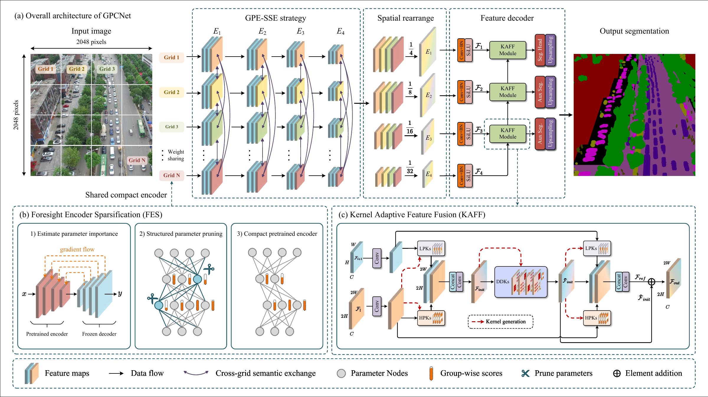

# GPCNet

Official implementation of **"GPCNet: Grid-Parallel Compact Network With Kernel-Adaptive Feature Fusion for Semantic Segmentation of High-Resolution UAV Imagery"**, published in **IEEE Transactions on Geoscience and Remote Sensing (TGRS), 2026**.

[Paper](https://doi.org/10.1109/TGRS.2026.3725031) · [Environment Setup](assets/ENVIRONMENTS.md) · [Datasets and Configurations](assets/DATASETS_AND_CONFIGS.md) · [Citation](#-citation)

## 📋 Abstract

High-resolution UAV imagery poses two challenges for semantic segmentation: the computational cost of global self-attention and inconsistent feature representations in scenes with rich textures and fine structures. GPCNet combines a compact pretrained encoder, efficient grid-parallel feature encoding, and kernel-adaptive decoding to address both challenges. Its compact MiT-B2 variant, **GPCNet-P**, achieves **72.32% mIoU on UAVid** and **81.31% mIoU on VDD**, while removing 40% of the encoder parameters before segmentation training.

## 🔧 Framework Overview

[](assets/overview.pdf)

GPCNet consists of three components:

1. **Foresight Encoder Sparsification (FES)** estimates parameter importance using the neural tangent kernel (NTK) trace on real UAV samples. It aggregates importance into dependency groups and iteratively removes redundant encoder parameters before training.
2. **Grid-Parallel Encoding with Stage-End Semantic Exchange (GPE-SSE)** processes nonoverlapping image grids through a shared encoder in parallel. The last Transformer block of each stage exchanges information across the full feature map to preserve cross-grid semantic context.
3. **Kernel-Adaptive Feature Fusion (KAFF)** progressively fuses multiscale features using spatially variable low-pass, high-pass, and dynamic dilated kernels, improving feature consistency and preserving fine structures.

The paper evaluates four variants:

| Variant   | Encoder | Encoder sparsity | Workflow               |
| --------- | ------- | ---------------- | ---------------------- |
| GPCNet    | MiT-B2  | 0%               | Train → Test          |
| GPCNet-P  | MiT-B2  | 40%              | Prune → Train → Test |
| GPCNet-S  | MiT-B1  | 0%               | Train → Test          |
| GPCNet-SP | MiT-B1  | 40%              | Prune → Train → Test |

## 💻 Usage

### Installation

```bash
git clone https://github.com/Memoristor/GPCNet.git
cd GPCNet
```

Follow [ENVIRONMENTS.md](assets/ENVIRONMENTS.md) to set up the environment, then build the spatial variable convolution (SVC) extension:

```bash
python -m pip install --no-build-isolation -e ./kernels/spatial_variable_convolution
python - <<'PY'
from svc import spatial_variable_convolution
print('SVC extension imported successfully')
PY
```

SVC requires an NVIDIA GPU and the CUDA toolkit with `nvcc`.

### Datasets and Configurations

Follow [Datasets and Configurations](assets/DATASETS_AND_CONFIGS.md) to prepare the data and select a configuration. Set `dataset.root_path` in the YAML file.

### Prune, Train, and Test

Run commands from the repository root. The wrapper accepts separate GPU lists and arguments for each phase:

```text
bash prune_train_test.sh CONFIG SEED PRUNE_GPUS PRUNE_ARGS TRAIN_GPUS TRAIN_ARGS TEST_GPUS TEST_ARGS
```

Example for GPCNet-P on UAVid:

```bash
CONFIG="configs/uavid/gpcnet_mit_b2/gpcnet_mit_b2_2048x2048_bs4_ep40_adamw_lr1e-4_wd_5e-2_semseg_decoder_1e-3_wd_5e-2_cosine_lsce_1e-1_dice_highreso_semseg_uavid.yaml"
SEED=212

bash prune_train_test.sh "$CONFIG" "$SEED" \
    0 "-i -w GPCNet" \
    0,1,2,3 "-i -w GPCNet" \
    0 "-i -w GPCNet"
```

| Argument      | Meaning                                                |
| ------------- | ------------------------------------------------------ |
| `-i`        | Disable Weights & Biases logging.                      |
| `-w GPCNet` | Set the project name used in the output path.          |
| `-r`        | Set the random seed when calling `main.py` directly. |

BatchNorm is converted to SyncBatchNorm automatically. Use **one GPU** for pruning and testing. For training, the total batch size must be divisible by the number of GPUs. Training starts from the pruned model in `last_epoch.pth`. Testing uses the updated checkpoint.

### Evaluate a Checkpoint

To evaluate the checkpoint with the best validation IoU, set `test.reload_pth: best_iou.pth` in the YAML configuration and run:

```bash
CUDA_VISIBLE_DEVICES=0 torchrun --standalone --nproc_per_node=1 \
    main.py -c "$CONFIG" -p test -r "$SEED" \
    -w GPCNet -i
```

Use `-p valid` and `valid.reload_pth` for validation. Checkpoint paths can be absolute or relative to the experiment's `checkpoints/` directory.

### Train a Dense Variant

To train GPCNet or GPCNet-S, skip pruning and use a separate project name:

```bash
CUDA_VISIBLE_DEVICES=0,1,2,3 torchrun --standalone --nproc_per_node=4 \
    main.py -c "$CONFIG" -p train -r "$SEED" \
    -w GPCNet-Dense -i

CUDA_VISIBLE_DEVICES=0 torchrun --standalone --nproc_per_node=1 \
    main.py -c "$CONFIG" -p test -r "$SEED" \
    -w GPCNet-Dense -i
```

### Outputs

Results are saved to:

```text
output/<project>/<dataset_class>/<model_class>/<config_stem>_seed_<seed>/
├── checkpoints/
│   ├── last_epoch.pth
│   ├── best_iou.pth
│   └── best_valid.json
├── logs/
├── wandb/
└── results/
    └── test/<checkpoint_stem>/
        ├── config.json
        ├── result.txt
        └── predictions/
```

Set `globals.output_root` to change the output root.

## 📈 Experimental Results

Results from **Tables II to V of the [paper](https://doi.org/10.1109/TGRS.2026.3725031)**. Accuracy is test mIoU (%). Efficiency is measured on one NVIDIA RTX 3090 with BF16, batch size 1, `2048 × 2048` inputs, and the eight-class UAVid output head.

| Model     | Encoder | Encoder sparsity | UAVid           | VDD             | FloodNet        | Params (M)     | FLOPs (G)        | FPS             |
| --------- | ------- | ---------------- | --------------- | --------------- | --------------- | -------------- | ---------------- | --------------- |
| GPCNet    | MiT-B2  | 0%               | 72.28           | **81.35** | **78.07** | 25.11          | 948.76           | 12.36           |
| GPCNet-P  | MiT-B2  | 40%              | **72.32** | 81.31           | 77.61           | 15.39          | 665.13           | 14.12           |
| GPCNet-S  | MiT-B1  | 0%               | 70.95           | 80.44           | 76.73           | 14.07          | 762.36           | 15.60           |
| GPCNet-SP | MiT-B1  | 40%              | 70.65           | 79.94           | 76.21           | **8.76** | **493.69** | **18.88** |

FloodNet mIoU averages the **nine foreground classes**, excluding Background.

## 🎓 Citation

If you find this work useful, please cite our paper:

```bibtex

@article{deng_gpcnet_2026,
  author={Deng, Changjian and Cheng, Jian and Yang, Zhiguo and Zhang, Yijie and Xia, Ziying and Zhou, Zijing and Tashi, Nyima},
  journal={IEEE Transactions on Geoscience and Remote Sensing}, 
  title={GPCNet: Grid-Parallel Compact Network With Kernel-Adaptive Feature Fusion for Semantic Segmentation of High-Resolution UAV Imagery}, 
  year={2026},
  volume={64},
  number={},
  doi={10.1109/TGRS.2026.3725031}
}
```

## 📄 License

This repository includes the [GNU General Public License v3.0](LICENSE). Third-party components retain their respective license notices.
